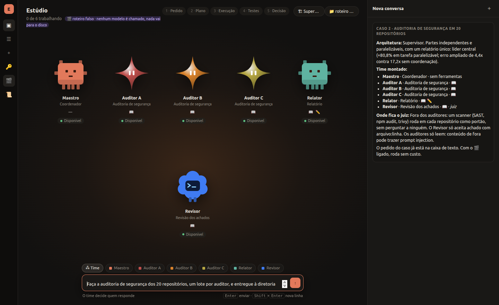
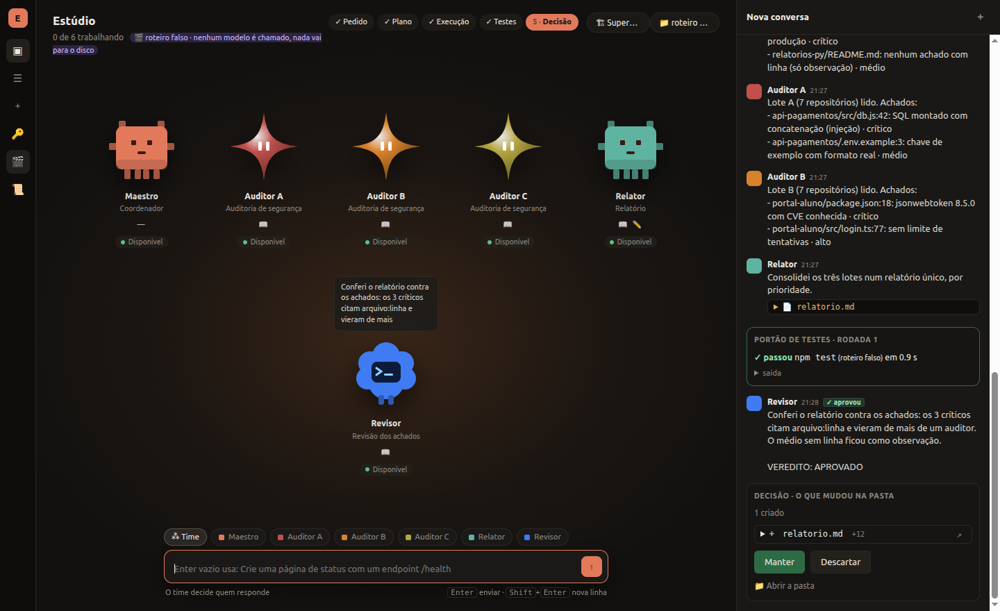
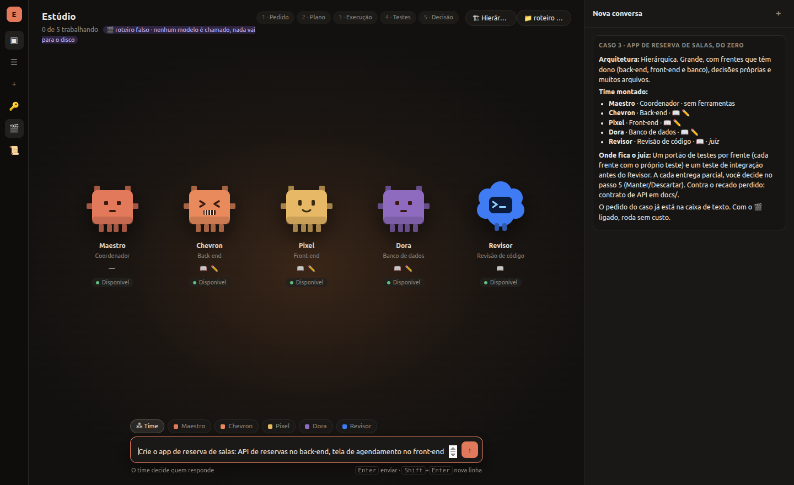
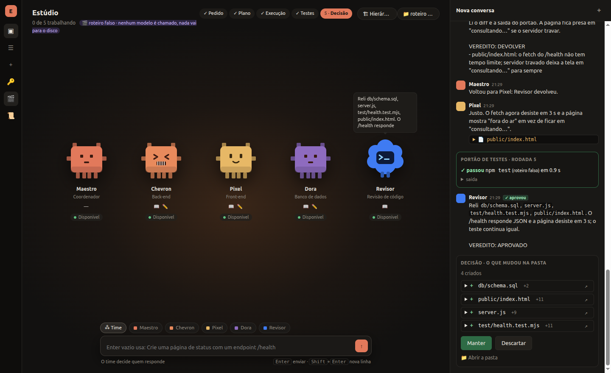
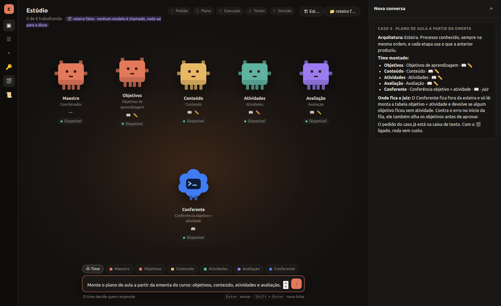
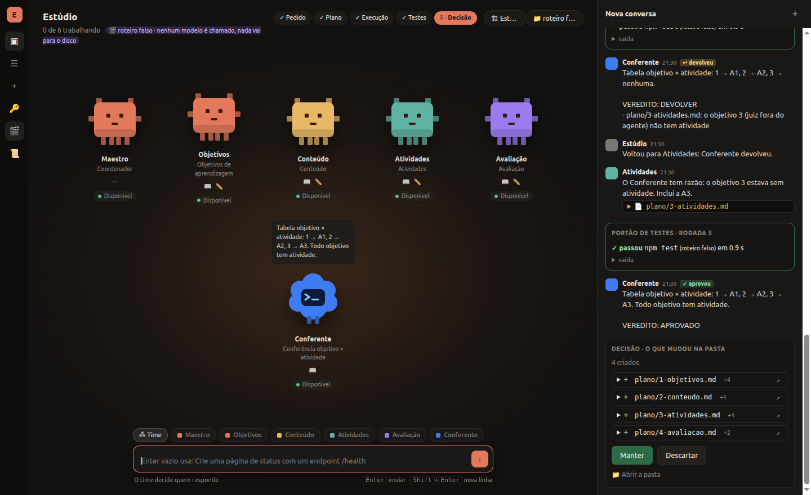
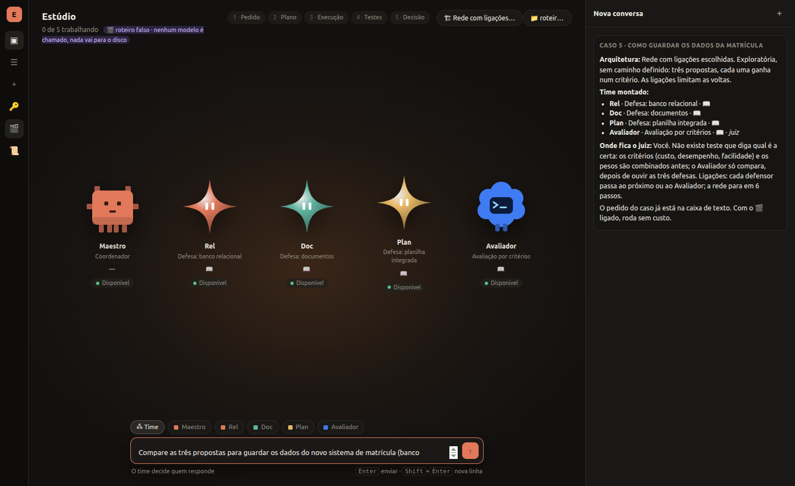
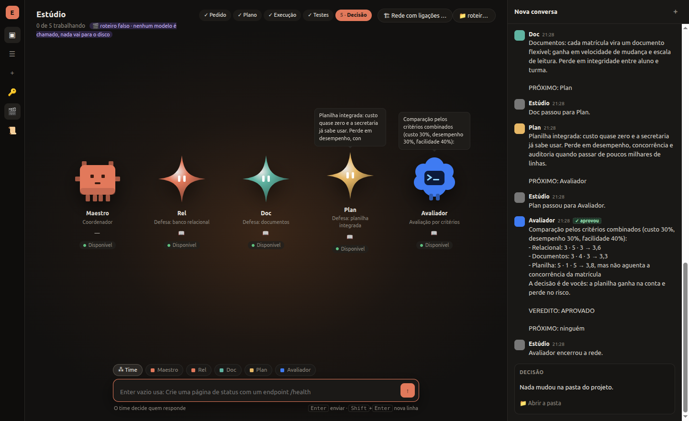
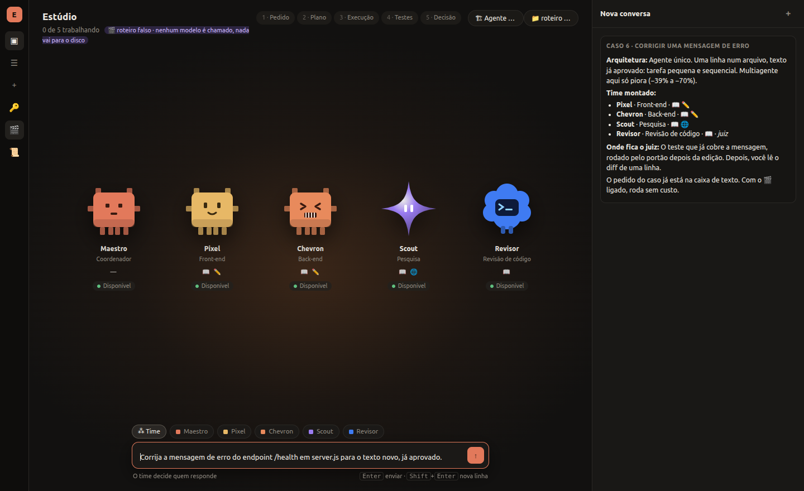
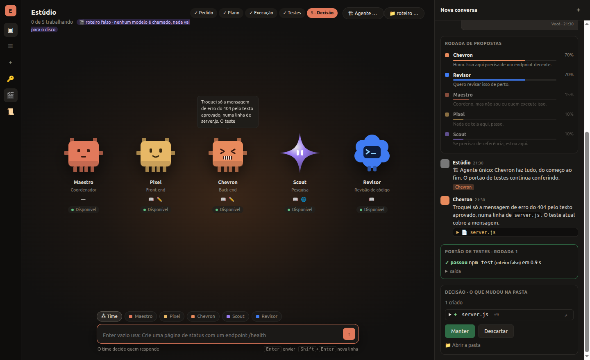

# Aula 17: casos 2 a 6 (arquitetura, time e juiz)

Critério da Aula 16: o tipo da tarefa decide, não o número de agentes. O juiz fica fora do agente.
No Estúdio, a arquitetura se escolhe no botão 🏗 do topo.

| Caso | Arquitetura | Time no Estúdio | Onde fica o juiz |
|---|---|---|---|
| 2. Auditoria de segurança em 20 repositórios | **Supervisor**: partes independentes e paralelizáveis, um relatório único (+80,8% com líder central em tarefa paralelizável; erro ampliado de 4,4x contra 17,2x sem coordenação) | Maestro (líder, sem ferramentas) distribui e consolida com prioridades. Auditores só leem (quem lê conteúdo de fora não escreve: risco de prompt injection) e devolvem poucas linhas por repositório. Revisor no fim | Scanner automático (SAST, `npm audit`, trivy) em cada repositório, sem perguntar ao agente. Revisor exige `arquivo:linha` em cada achado |
| 3. App de reserva de salas, do zero | **Hierárquica**: grande, com frentes que têm dono | Maestro divide entre sub-líderes: Back (Chevron), Front (Pixel) e Dados (agente "Banco de dados"). Contrato de API em `docs/` para o recado não se perder. Revisor no fim | Portão de testes por frente e teste de integração antes do Revisor. A cada entrega parcial, decisão humana (Manter/Descartar) |
| 4. Plano de aula a partir da ementa | **Esteira**: processo conhecido, sempre na mesma ordem | Objetivos → Conteúdo → Atividades → Avaliação (no Estúdio: Esteira ou Construtor) | O coordenador confere no fim, sem escrever, com uma tabela objetivo × atividade (todo objetivo precisa de uma atividade). Também uma checagem depois dos objetivos (erro no início da fila) |
| 5. Como guardar os dados da matrícula | **Rede com ligações escolhidas**: exploratória, sem caminho definido | Defensores de Relacional, Documentos e Planilha passam para o Avaliador; o Avaliador volta para eles. Limite de 6 passos contra voltas sem fim | **Humano**: não existe teste que decida. Critérios com pesos (custo, desempenho, facilidade) definidos antes; o Avaliador só compara |
| 6. Corrigir uma mensagem de erro | **Agente único**: uma linha, texto aprovado (multiagente em tarefa sequencial piora de 39% a 70%) | Clique direto no chip do agente dono do arquivo, sem Maestro e sem Revisor | O teste atual, rodado pelo portão depois da edição. Depois, você lê o diff de uma linha |

## Os times montados no Estúdio

No Estúdio: botão 🏗 → **Casos da Aula 17** → escolha o caso. O time, a arquitetura e as ligações são carregados, o
card do caso aparece no chat e o pedido de exemplo fica na caixa de texto. Com o 🎬 ligado, a rodada roda sem custo.
Para voltar ao começo, use 🏗 → **Time padrão**.

| Caso | Time montado | Rodada (roteiro 🎬) |
|---|---|---|
| 2. Auditoria |  |  |
| 3. Reserva de salas |  |  |
| 4. Plano de aula |  |  |
| 5. Dados da matrícula |  |  |
| 6. Mensagem de erro |  |  |

O que cada rodada mostra:

- **Caso 2:** os três auditores leem em paralelo e devolvem achados com `arquivo:linha`. O Relator consolida tudo em `relatorio.md`, por prioridade, e o Revisor dos achados aprova.
- **Caso 3:** o Maestro divide em três frentes (Back-end, Front-end e Banco de dados). Uma falha do portão que cita arquivo de outra frente não volta para esta. O Revisor fecha.
- **Caso 4:** a esteira passa de etapa em etapa. O Conferente monta a tabela objetivo × atividade e devolve, porque o objetivo 3 ficou sem atividade. Atividades corrige, e ele aprova.
- **Caso 5:** Rel → Doc → Plan → Avaliador, que compara pelos critérios com pesos e deixa a decisão com o grupo. Nada é gravado.
- **Caso 6:** um agente só troca uma linha, e o teste atual, rodado pelo portão, é o juiz.
